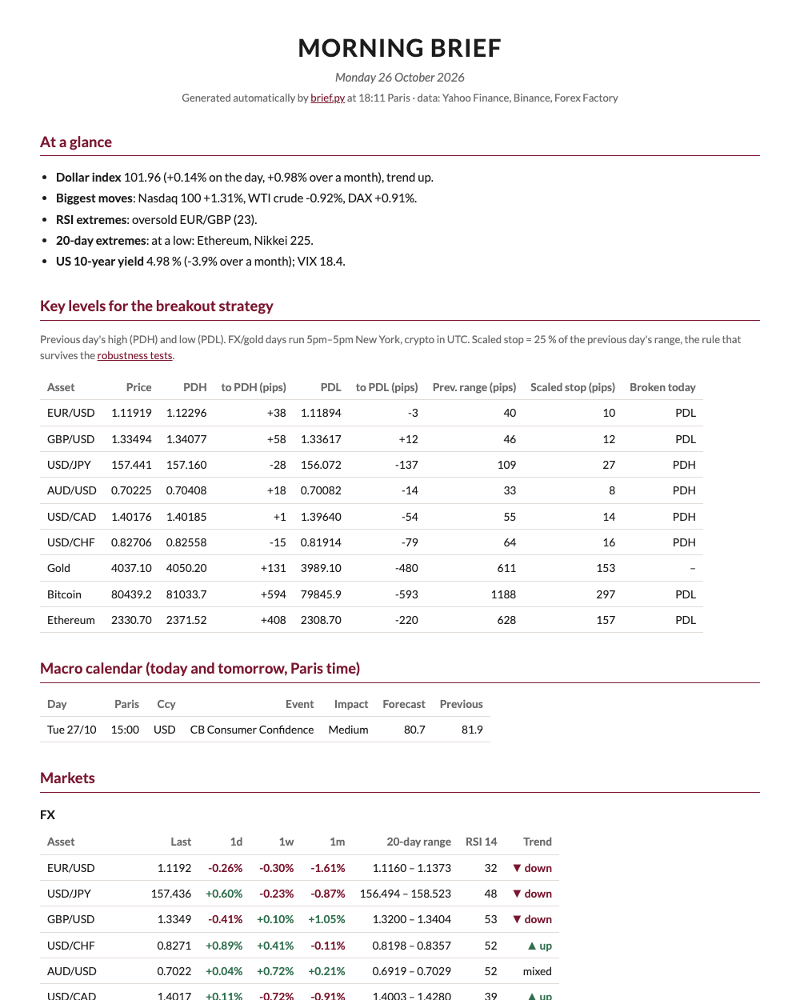
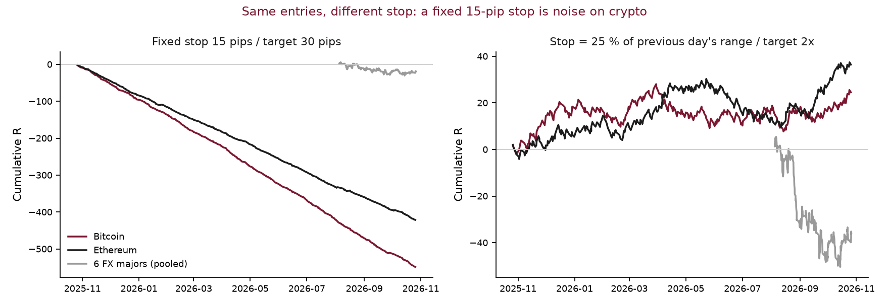
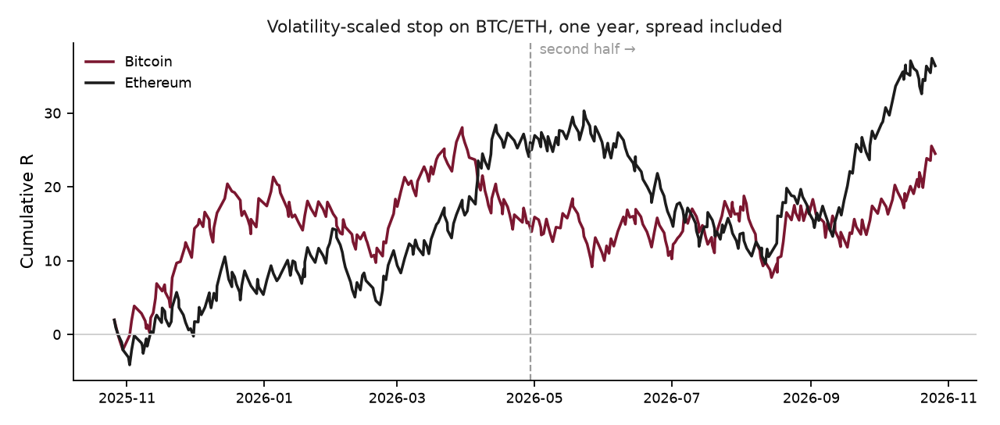

# Markets research lab

Python tools I use to follow FX, gold and crypto markets and to test my own intraday strategy:
a **morning brief published automatically every weekday** (market snapshot, key levels and setups with rule-based
arguments, macro calendar, headlines), a **backtest** of a previous-day high/low breakout,
**robustness tests** to check whether the result is real or luck, and a **real-time alert monitor**.

**[→ Today's morning brief](https://alban245.github.io/markets-research-lab/)** ·
**[→ Archive](https://alban245.github.io/markets-research-lab/archive.html)** · **[→ Full robustness report](results/report.md)**

[](https://alban245.github.io/markets-research-lab/)

## The strategy in one minute

I scalp (trades of a few minutes to a few hours) on FX majors, gold, Bitcoin and Ethereum with one rule:

- **Entry**: buy as soon as price breaks above the **previous day's high**, sell as soon as it breaks below the
  **previous day's low**. These levels are widely watched, so a clean break often brings momentum.
- **Exit, my original rule**: a **stop-loss 15 pips** away and a **profit target 30 pips** away (a pip is the smallest
  standard price step: 0.0001 on EUR/USD). I risk 1 to make 2, so I only need to win one trade in three to break even.
- **Exit, the alternative I test**: the same 1-to-2 ratio, but the stop is sized to volatility: **25 % of the previous
  day's range** (high minus low), so it widens on volatile days and assets, and tightens on quiet ones.

Results are measured in **R**: 1R is the amount risked on a trade. +2R is a winning trade, −1R a losing one.

**The question**: does my original rule make money once the bid-ask spread is paid, and does a volatility-scaled stop
do better?

## Results

~1,040 trades per rule on 9 assets, 5-minute candles, spread included. 1R = the amount risked on a trade.



| Mean result per trade | My original rule: 15-pip stop, 30-pip target | Volatility-scaled stop (25 % of previous day's range) |
|---|---|---|
| Bitcoin (331 trades, 1 year) | **−1.66 R** per trade | **+0.07 R** [−0.07 ; +0.22] |
| Ethereum (325 trades, 1 year) | **−1.30 R** | **+0.11 R** [−0.03 ; +0.26] |
| 6 FX majors pooled (335 trades, 60 days) | −0.06 R [−0.19 ; +0.08] | −0.11 R [−0.25 ; +0.04] |
| Gold (51 trades, 60 days) | −1.08 R | −0.35 R [−0.64 ; −0.03] |

*Brackets: 95 % bootstrap interval of the mean (10,000 resamples).*

**What I take from it**

1. **A fixed stop in pips is meaningless across assets.** 15 pips is $15 on Bitcoin, less than one 5-minute candle:
   almost every trade is stopped out (0–1 % win rate). Scaling the stop to the previous day's range turns the same
   entries from −1.7 R / −1.3 R into roughly break-even-plus on crypto.
2. **The crypto result is consistent but not yet proven.** BTC + ETH pooled: +0.09 R per trade, positive in 96 % of
   bootstrap resamples, but the 95 % interval still touches zero [−0.01 ; +0.20]. It holds on both halves of the year
   (+0.12 R, then +0.06 R) and on the 45 trades taken since I wrote the rule down on 30 Sep 2026 (+0.40 R, small sample).
3. **No edge on FX majors** with either stop over the last 60 days. USD/CAD and gold are significantly negative with
   the scaled stop.
4. **Breakouts around US data releases are the worst trades.** FX and gold breakouts triggered between 8:15 and 8:45am
   New York time (NFP, CPI, PCE…) or around FOMC statements lost **−0.43 R** per trade, against −0.17 R for the rest
   of the day. I first spotted it on a PCE release day, when my rule would have hit four stops in five minutes.



## Limitations and next steps

- **FX history is short**: Yahoo Finance only serves 60 days of 5-minute data. Next step: 2–5 years of Dukascopy data.
- **Costs are a flat spread per asset.** Real spreads widen at the 5pm New York rollover (I have seen 6 pips on
  EUR/USD instead of ~1) and slippage on releases is not modelled.
- The scaled-stop rule (25 % of range, target 2x) was picked by reasoning, not optimised, but both halves of the crypto
  year were visible when I chose it. The forward test since 1 Oct 2026 is the only true out-of-sample, and it is small.
- Entries are filled exactly at the level, and when a candle touches both stop and target the loss is counted.

## What is in the repo

| File | What it does |
|---|---|
| [`brief.py`](brief.py) | Builds the morning brief: at a glance, setups to watch with rule-based arguments for/against, key levels, headlines, week calendar, markets, charts → `docs/` |
| [`.github/workflows/brief.yml`](.github/workflows/brief.yml) | Runs `brief.py` every weekday at 06:00 UTC on GitHub Actions and publishes it on GitHub Pages |
| [`news.py`](news.py) | Latest headlines from public RSS feeds (FXStreet, Investing.com, Fed, ECB, CoinDesk), listed without commentary |
| [`market.py`](market.py) | Market snapshot: changes, 20-day range, 50/200-day moving averages, RSI 14, trend |
| [`macro_calendar.py`](macro_calendar.py) | Macro calendar from the Forex Factory feed, Paris time |
| [`charts.py`](charts.py) | Inline SVG charts for the brief (performance bars, 6-month curves with moving averages) |
| [`backtest.py`](backtest.py) | The breakout backtest, two stop rules, spread included |
| [`research.py`](research.py) | Robustness: equity curves, bootstrap, split-sample and out-of-sample, macro release windows |
| [`monitor.py`](monitor.py) | Live monitor: alerts when price nears or breaks a level, with stop/target and nearby releases |
| [`test_backtest.py`](test_backtest.py) | Checks on the trade logic (stop vs target order, end-of-day exit) |
| `data/` | Frozen snapshot of the 5-minute candles used for the published numbers |

## Run it

```bash
python -m venv .venv && source .venv/bin/activate
pip install -r requirements.txt
python test_backtest.py   # logic checks
python backtest.py        # results on the frozen data (add --refresh for fresh data)
python research.py        # robustness report and charts in results/
python brief.py           # today's morning brief in docs/ (also runs daily on GitHub Actions)
python monitor.py --once  # today's key levels (without --once: live alerts, macOS)
```

---
Alban Laurens · EDHEC Business School, Master in Management (Finance track) ·
[LinkedIn](https://www.linkedin.com/in/alban-laurens) · Personal research, not investment advice.
